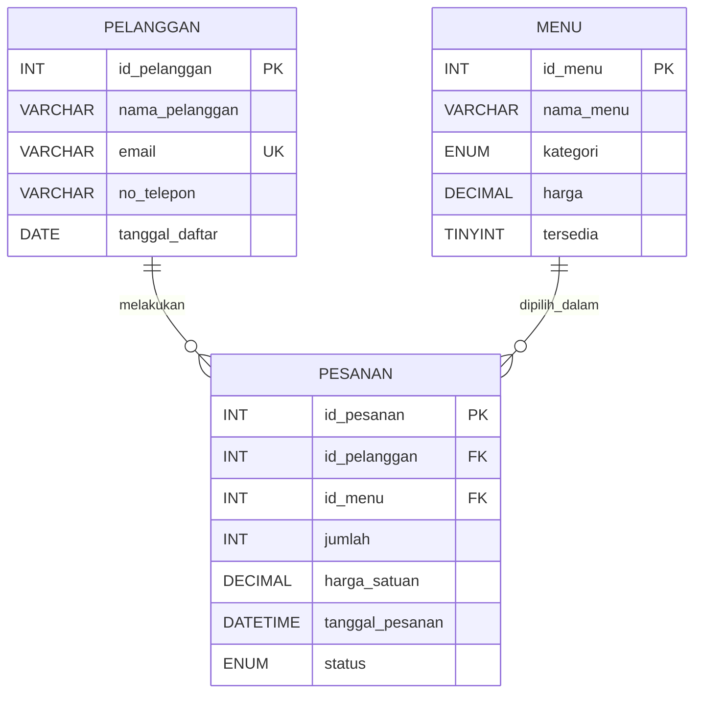

# MIDS Coffee — Database Dashboard

**Tugas Mentoring ISCOM Programming Day 3**  
**Nama:** Muhammad Indra Dwi Syahputra  
**NPM:** 26081010096  
**Tema:** Database kafe MIDS Coffee — menu, pelanggan, dan pesanan.

Website PHP yang mengambil data **langsung dari MySQL** dan menampilkannya menjadi **3 tabel HTML dinamis** menggunakan `mysqli`, `SELECT`, `JOIN`, `while`, dan `fetch_assoc()`. Dilengkapi fitur **CRUD untuk ketiga tabel** (Create / Read / Update / Delete). CSS dibuat responsif untuk laptop dan HP, memakai satu warna brand (cokelat kopi: `#a34a28`).

## 1. Struktur proyek

```text
26081010096_MuhammadIndraDwiSyahputra_MIDSCoffee/
├── index.php                  # Dashboard + 3 tabel data dinamis
├── manage.php                 # Form tambah/edit dan pemrosesan CRUD (POST)
├── services/
│   └── config.php             # Koneksi mysqli (host, user, password, database, port)
├── css/
│   └── style.css              # Tampilan responsif (flexbox, grid, box model)
├── database/
│   ├── schema.sql             # CREATE DATABASE/TABLE (PK, FK) + data awal
│   └── sample_queries.sql     # SELECT, JOIN, UPDATE, DELETE (challenge 1)
└── README.md                  # Dokumentasi ERD dan cara menjalankan
```

## 2. Cara menjalankan di Laragon dan DBeaver

**Persyaratan:** Laragon (Apache, MySQL/MariaDB), DBeaver, browser. Direkomendasikan PHP 8.0 atau lebih baru karena menggunakan `match` dan union types.

1. **Ekstrak folder proyek** ke Document Root Laragon (biasanya `C:\laragon\www\`; jika sudah mengubah Document Root, gunakan lokasi yang kamu atur). Jangan hanya membuka `index.php` dengan double click; aplikasi PHP harus dijalankan melalui server.
2. Buka **Laragon → Start All**. Pastikan **Apache** dan **MySQL** sudah aktif. Catat port MySQL (biasanya `3306`).
3. Buka **DBeaver → New Connection → MySQL**, lalu isi `localhost` / `127.0.0.1`, **port sesuai Laragon**, user `root`, dan password sesuai pengaturan Laragon (sering kosong). Klik **Test Connection**, lalu **Finish**.
4. **Khusus instalasi pertama yang belum punya database:** Buka `database/schema.sql` di SQL Editor DBeaver lalu **jalankan seluruh script** (*Execute SQL Script*, biasanya `Alt + X`). **Penting:** file ini menghapus dan membuat ulang tiga tabel. **Jika kamu sudah menjalankan versi MIDS Coffee sebelumnya dan datanya berhasil tampil, JANGAN jalankan `schema.sql` lagi**. Cukup ganti/tambahkan file PHP dan CSS terbaru agar data tetap aman.
5. Secara default `services/config.php` menggunakan:

   | Pengaturan | Nilai awal |
   | --- | --- |
   | Host | `127.0.0.1` |
   | Port | `3306` |
   | User | `root` |
   | Password | *(kosong)* |
   | Nama database | `mids_coffee` |

   Jika port/password berbeda, ubah nilai pada `services/config.php` atau gunakan environment variable `DB_HOST`, `DB_PORT`, `DB_USER`, `DB_PASSWORD`, `DB_NAME`. Pastikan ekstensi PHP `mysqli` aktif.
6. Buka halaman di browser:

   ```text
   http://localhost/26081010096_MuhammadIndraDwiSyahputra_MIDSCoffee/
   ```

   Jika folder kamu diganti namanya, sesuaikan URL. Masing-masing dari ketiga tabel harus menampilkan baris data MySQL. **Jangan menggunakan Live Server VS Code** untuk menjalankan PHP.
7. Setelah itu, buka `database/sample_queries.sql` di DBeaver lalu jalankan sesuai petunjuk **Challenge 1** di bagian 5. Refresh website untuk melihat perubahan.

## 3. Entitas, atribut, relasi, dan kardinalitas (ERD)



### Penjelasan entitas

| Entitas/tabel | Fungsi | Atribut dan ketentuan |
| --- | --- | --- |
| `menu` (master 1) | Daftar kopi, non-kopi, makanan | `id_menu` (PK), `nama_menu`, `kategori`, `harga`, `tersedia` |
| `pelanggan` (master 2) | Menyimpan data pembeli | `id_pelanggan` (PK), `nama_pelanggan`, `email` (UNIQUE), `no_telepon`, `tanggal_daftar` |
| `pesanan` (transaksi) | Menghubungkan pelanggan dan menu | `id_pesanan` (PK), `id_pelanggan` (FK), `id_menu` (FK), `jumlah`, `harga_satuan`, `tanggal_pesanan`, `status` |

**Primary Key (PK):** ID yang unik dan tidak kosong untuk tiap baris.  
**Foreign Key (FK):** `pesanan.id_pelanggan` mengacu ke `pelanggan.id_pelanggan`; `pesanan.id_menu` mengacu ke `menu.id_menu`.  
**Kardinalitas 1-to-Many:** satu **pelanggan** dapat memiliki **banyak pesanan**; satu **menu** juga bisa dipesan dalam **banyak pesanan**. Satu baris pesanan merujuk pada **tepat satu pelanggan dan satu jenis menu** (dengan `jumlah` unit).  
**Aturan integritas:** `ON UPDATE CASCADE` dan `ON DELETE RESTRICT` mencegah penghapusan data master yang masih digunakan pesanan.

**Mengapa ada `harga_satuan`?** Harga menu di tabel master bisa berubah, tetapi total pesanan lama harus tetap memakai harga pada saat pembelian. `total_harga` ditampilkan melalui perhitungan `jumlah * harga_satuan` pada SQL (tanpa perlu kolom tambahan).

## 4. Tampilan aplikasi web

- **Tabel menu:** `SELECT ... FROM menu` → ID, nama menu, kategori, harga, tersedia/habis; tambah, edit, dan hapus menu.
- **Tabel pelanggan:** `SELECT ... FROM pelanggan` → ID, nama, email, nomor telepon, tanggal terdaftar; tambah, edit, dan hapus pelanggan.
- **Tabel pesanan:** `SELECT ... FROM pesanan INNER JOIN pelanggan ... INNER JOIN menu ...` → ID, pelanggan, menu, jumlah, total harga, status, tanggal; tambah, edit, dan hapus pesanan.
- **Ringkasan otomatis:** total menu, total pelanggan, jumlah pesanan, omzet khusus pesanan berstatus **Selesai**.
- PHP membuka koneksi menggunakan `new mysqli(...)`, mengambil baris query dengan `while ($row = $result->fetch_assoc())`, lalu membangun tabel HTML berdasarkan hasil query. Setiap keluaran teks database diamankan memakai `htmlspecialchars()`.
- Styling: `display: flex` pada navigasi/hero; `display: grid` untuk kartu ringkasan; padding, border, shadow pada card; media query dan horizontal scrolling agar tabel tetap bisa diakses dari HP.

## 5. Challenge 1 — praktik query di DBeaver

Semua query berikut **sudah tersedia** dalam `database/sample_queries.sql` dan dapat dijalankan di DBeaver:

**SELECT biasa**

```sql
SELECT * FROM menu;
```

**SELECT JOIN 3 tabel**

```sql
SELECT p.id_pesanan, pl.nama_pelanggan, m.nama_menu, p.jumlah, p.status
FROM pesanan p
JOIN pelanggan pl ON pl.id_pelanggan = p.id_pelanggan
JOIN menu m ON m.id_menu = p.id_menu;
```

**UPDATE harga minuman**

```sql
UPDATE menu SET harga = 25000 WHERE id_menu = 2;
```

**DELETE pesanan dibatalkan**

```sql
DELETE FROM pesanan WHERE id_pesanan = 8 AND status = 'Dibatalkan';
```

Sebelum eksekusi: **8 menu, 6 pelanggan, 8 pesanan**. Setelah UPDATE/DELETE di file contoh: **8 menu, 6 pelanggan, 7 pesanan**. Harga **Es Kopi Susu Aren** naik dari **Rp 23.000** menjadi **Rp 25.000**; pesanan dibatalkan dengan **ID 8** terhapus. Masing-masing tabel tetap berisi **minimal 5 baris**. Refresh website untuk melihat hasil. Untuk mengembalikan kondisi awal, jalankan `schema.sql` lagi (data pada 3 tabel direset).

> Catatan: Data awal disediakan sebagai simulasi untuk latihan, bukan transaksi asli. Contoh UPDATE/DELETE di DBeaver tetap tersedia sebagai bagian tugas meskipun kini dashboard juga mendukung CRUD.

## 5a. Fitur tambahan — CRUD pada website

**Tidak membutuhkan SQL tambahan atau perubahan struktur database** jika schema awal telah berhasil diimpor.

1. Buka dashboard lalu cari bagian **Daftar menu**, **Data pelanggan**, atau **Riwayat pesanan**.
2. Klik **+ Tambah ...** untuk mengisi formulir baru; klik **Edit** pada sebuah baris untuk memperbarui; klik **Hapus** untuk menghapus dengan konfirmasi.
3. Setelah disimpan, browser kembali ke tabel terkait dan muncul pesan berhasil/gagal. Ringkasan total di atas otomatis berubah.
4. Pada **pesanan**, pilih nama pelanggan, menu, kuantitas, status, dan waktu. Harga satuan diambil otomatis dari menu saat transaksi dibuat. Saat mengedit status/jumlah pesanan lama, harga satuan lama tetap disimpan. Jika menu diubah, harga satuan mengikuti menu baru.
5. **Menu/pelanggan yang masih direferensikan pesanan tidak bisa dihapus** (`ON DELETE RESTRICT`). Hapus pesanan terkait terlebih dahulu jika memang ingin menghapus master.
6. Username dan password koneksi **tetap memakai `services/config.php`**. Tidak ada tabel/kolom baru yang harus dibuat.

Untuk keamanan contoh lokal ini, penulisan database menggunakan **prepared statements**, keluaran HTML di-*escape*, pengubahan/penghapusan melalui **POST dan token CSRF**, validasi kolom dan konfirmasi sebelum hapus. Proyek ini ditujukan untuk localhost/demonstrasi tugas; **tambahkan sistem login dan otorisasi** jika ingin dipublikasikan sebagai aplikasi sungguhan. Jangan unggah kredensial database sungguhan ke GitHub.


**Penting:** PHP/MySQL memerlukan server, jadi **tidak bisa dijalankan lewat GitHub Pages**. GitHub dipakai sebagai pengumpulan kode; jalankan demonya secara lokal di Laragon.
